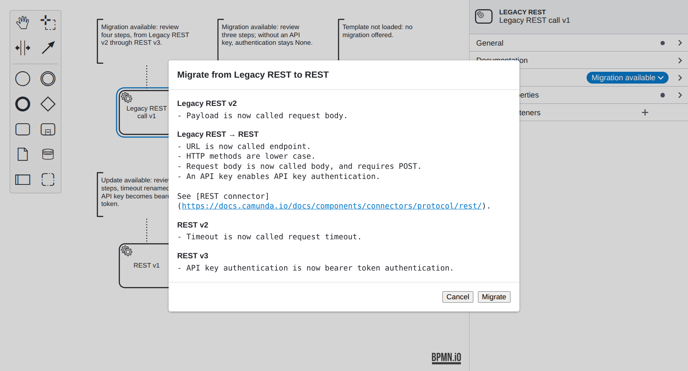

# `@bpmn-io/element-template-changelog`

[](https://github.com/bpmn-io/element-template-changelog/actions/workflows/CI.yml)

A simple _review changes_ component for [`bpmn-js-element-templates`](https://github.com/bpmn-io/bpmn-js-element-templates).




## Usage

```javascript
import BpmnModeler from 'bpmn-js/lib/Modeler';

import '@bpmn-io/element-template-changelog/assets/element-template-changelog.css';

import ElementTemplateChangelogModule from '@bpmn-io/element-template-changelog';

const modeler = new BpmnModeler({
  additionalModules: [
    ...
    ElementTemplateChangelogModule
  ],
  ...
});

// review via the properties panel, _OR_
// open the changelog programmatically
const elementTemplates = modeler.get('elementTemplates');

const update = elementTemplates.getUpdate(element);

const { changes } = elementTemplates.getUpdateDetails(element, update.template);

await modeler.get('elementTemplateChangelog').open({
  oldTemplate: elementTemplates.get(element),
  newTemplate: update.template,
  changes
});

// apply the new template, once confirmed
elementTemplates.applyTemplate(element, update.template);
```


## Build and Run

Prepare the project by installing all dependencies:

```sh
npm install
```

Then, depending on your use-case you may run any of the following commands:

```sh
# lint and run all tests
npm run all

# spin up the playground
npm start

# run the full development setup
npm run dev
```

> [!NOTE]
> We do not generate any build artifacts. Required parts of the library should be bundled by consuming libraries as needed instead.


## License

MIT
